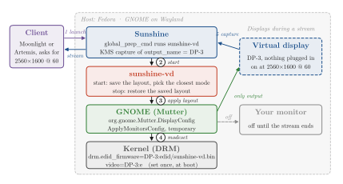

# sunshine-vd

**Pantalla virtual a demanda para [Sunshine](https://github.com/LizardByte/Sunshine) en GNOME (Wayland). Sin enchufe falso y sin módulos de kernel.**

Cuando un cliente de Moonlight o Artemis se conecta, tu monitor se apaga y el escritorio pasa a una pantalla virtual con la resolución y los Hz del cliente. La tablet recibe su resolución nativa, la tele de un amigo 1080p60 y la Steam Deck 1280x800 a 90. Al salir del stream, todo vuelve a como estaba.

Es lo que hace la pantalla virtual de [Apollo](https://github.com/ClassicOldSong/Apollo) en Windows, pero para GNOME en Linux y encima del Sunshine que ya usás.

_[Read in English](README.md)_

<p align="center"></p>
<p align="center"><sub>Qué pasa cuando se conecta un cliente. Al salir de la app, <code>sunshine-vd stop</code> restaura tu configuración guardada.</sub></p>

## Estado

| | |
|---|---|
| **Probado** | Fedora 45 Workstation · GNOME en Wayland · NVIDIA RTX 3070 (driver propietario 615) · Sunshine en RPM |
| **Debería andar, sin probar** | GPUs AMD e Intel: la parte del kernel es DRM genérico. Si lo probás, abrí un [reporte de compatibilidad](https://github.com/Santi2065/sunshine-vd/issues/new?template=compatibility_report.yml). |
| **Todavía no** | KDE Plasma (usá [Sunveil](https://github.com/ImStillBlue/sunshine-virtual-display)) · Fedora atómico (Silverblue, Bazzite) · el instalador en distros que no son Fedora (hay [pasos manuales](docs/how-it-works.md#manual-installation)) · Sunshine en Flatpak (no puede capturar por KMS) |

## Cómo funciona

1. **Kernel.** Se fuerza como "conectado" un DisplayPort/HDMI libre de la placa y se le carga un EDID propio (`drm.edid_firmware=` + `video=<conector>:e`). GNOME ve un monitor que no existe, con las resoluciones de tus clientes. No hay módulos de kernel, así que Secure Boot no molesta.
2. **Empieza el stream.** El `global_prep_cmd` de Sunshine corre `sunshine-vd start`. Usando la API de pantallas de GNOME (`org.gnome.Mutter.DisplayConfig`), deja la virtual como única pantalla, en el modo más parecido al que pidió el cliente.
3. **Termina el stream.** `sunshine-vd stop` restaura tu disposición de pantallas.

El detalle técnico está en [docs/how-it-works.md](docs/how-it-works.md), en inglés.

## Requisitos

- **Distro:** Fedora no atómico, que trae `grubby` y `dracut`.
- **Escritorio:** GNOME en Wayland.
- **Sunshine:** instalado nativo (RPM) y capturando por KMS, que es lo que hace el RPM por defecto.
- **Bindings de Python:** `python3-gobject`, que viene con Fedora Workstation.
- **Hardware:** un DisplayPort o HDMI libre en la placa, sin nada enchufado.

## Instalación

```bash
git clone https://github.com/Santi2065/sunshine-vd
cd sunshine-vd
./install.sh --check   # muestra el plan, no cambia nada
./install.sh           # pide tu contraseña de sudo
# reiniciar
./install.sh --finish  # cuando GNOME pregunte si mantener la configuración de pantallas: Mantener cambios
```

Entre el reinicio y `--finish`, GNOME trata a la pantalla virtual como un monitor real. Si el login no aparece en tu monitor, entrá a ciegas: Enter, tu contraseña y Enter.

El instalador toca esto:
- **El archivo del EDID**, en `/usr/lib/firmware/edid/sunshine-vd.bin`, que además agrega al initramfs.
- **Dos parámetros del kernel**, con `grubby`, en todas las entradas de arranque menos la de rescate (que queda como salida de emergencia). `grubby` también actualiza `GRUB_CMDLINE_LINUX` en `/etc/default/grub`. Si tu línea de comandos ya tiene argumentos `video=` propios, el instalador se frena, porque `grubby` los reemplazaría.
- **El helper y su configuración:** `~/.local/bin/sunshine-vd` y `~/.config/sunshine-vd/` (la configuración, más tu disposición de pantallas guardada antes de reiniciar, para que `--finish` la restaure tal cual).
- **`sunshine.conf`:** le agrega una entrada en `global_prep_cmd`, más `capture = kms` y `output_name = <conector>`. Mantiene tus prep commands existentes y hace backup antes.
- **La disposición de pantallas de GDM** (solo si confirmás), para que el login no aparezca en la pantalla virtual.

`./uninstall.sh` deshace todo. `output_name` y `capture` en `sunshine.conf` solo se restauran si siguen teniendo los valores que puso el instalador.

## Uso

Conectate desde Moonlight o Artemis y elegí la resolución y los FPS en el cliente. Para volver a tu monitor, **salí** de la app desde el cliente (Quit). Si solo desconectás, Sunshine deja la sesión abierta y la virtual sigue prendida.

| Comando | Qué hace |
|---|---|
| `sunshine-vd status` | Muestra qué pantallas están prendidas y en qué modo |
| `sunshine-vd doctor` | Hace un diagnóstico: kernel, EDID, GNOME, config de Sunshine y si hay dos Sunshine corriendo |
| `sunshine-vd stop` | Restaura tus monitores, por ejemplo si un stream terminó mal. Super+P en GNOME también sirve. |
| `sunshine-vd connectors` | Lista los conectores de la placa y cuál usaría el instalador |
| `sunshine-vd modes --test 2340 1080 120` | Muestra qué modo recibiría un cliente que pide eso |

Steam Big Picture y los juegos que lances desde ahí abren en la pantalla virtual, porque durante el stream es la única. Dejá los juegos en pantalla completa sin bordes (*borderless*) para que sigan la resolución del cliente.

## Modos

El EDID por defecto cubre los clientes más comunes. El primer modo de la lista es el preferido.

| Resolución | Hz | Cliente típico |
|---|---|---|
| 1920x1080 | 60, 120 | teles, notebooks |
| 2560x1440 | 60, 120 | monitores, teles 1440p |
| 3840x2160 | 60 | teles 4K (escala 2) |
| 1280x720 | 60 | conexiones lentas |
| 2560x1600 | 60 | tablets 16:10 |
| 1280x800 | 60, 90 | Steam Deck (LCD / OLED) |
| 2400x1080 | 60, 120 | celulares 20:9 |

Si un cliente pide algo que no está en la lista, el modo se elige en este orden:
1. La proporción más parecida.
2. Dentro de esa, una resolución que llegue a los Hz pedidos. En juegos pesan más los fps que los píxeles.
3. La más chica que cubra lo pedido, porque es mejor achicar que agrandar.

Sunshine escala lo que falte. Un pedido de 4K a 120 recibe 2560x1440 a 120, y una tele de 1366x768 recibe 1080p.

Para usar tus propios modos, reinstalá con `MODES` y reiniciá:

```bash
# Tablet 17:12 a mitad de resolución (por ejemplo, OnePlus Pad 3)
MODES="1696x1200@60,1696x1200@120,1696x1200@144,3392x2400@60,1920x1080@60,1920x1080@120,3840x2160@60,1280x720@60" ./install.sh
```

**Límites:**
- Hasta 8 modos con timing propio, más los modos estándar de tele gratis (1920x1080 a 60/120, 3840x2160 a 60 y 1280x720 a 60).
- Hasta 655 MHz de pixel clock por modo, así que 4K a 120 no entra.

## Configuración

`~/.config/sunshine-vd/config` se aplica en el próximo stream:

| Clave | Por defecto | Qué hace |
|---|---|---|
| `CONNECTOR` | lo pone el instalador | Conector de la pantalla virtual |
| `DISABLE_PHYSICAL` | `true` | `false` agrega la virtual a la derecha de tus monitores en vez de reemplazarlos |
| `SCALE` | `auto` | `auto` usa 1 por debajo de 2000 px de alto y 2 de ahí para arriba; o un valor fijo como `1.5` |
| `WAKE_DISPLAYS` | `true` | Despierta las pantallas apagadas antes de cambiar |
| `INHIBIT_IDLE` | `true` | Evita que GNOME apague o bloquee la pantalla durante el stream |
| `SETTLE_SECONDS` | `1.5` | Pausa después del cambio, antes de que Sunshine empiece a capturar |
| `SUNSHINE_CONF` | vacío | Ruta de `sunshine.conf`, si no es la de siempre |

## Problemas

Ver [docs/troubleshooting.md](docs/troubleshooting.md), en inglés. Los dos casos más importantes:

- **Sin imagen después de reiniciar:** arrancá la entrada "rescue" desde el menú de GRUB, o apretá `e` en la entrada normal, borrá `drm.edid_firmware=…` y `video=…:e` de la línea `linux`, y arrancá con Ctrl+X. Después corré `./uninstall.sh`. Los kernels anteriores no sirven, porque también tienen los parámetros.
- **Tu monitor queda negro después de streamear:** corré `sunshine-vd stop` (por SSH si hace falta) o apretá Super+P.

## Limitaciones

- **Sin HDR ni VRR en la pantalla virtual con NVIDIA.** El driver solo los ofrece en conexiones HDMI 2.1 reales, así que en teles HDR el stream sale en SDR.
- **Los modos nuevos del EDID requieren reiniciar.** NVIDIA lee el EDID una sola vez, al arrancar.
- **Dejá libre el puerto de la pantalla virtual.** No enchufes un monitor real ahí mientras sunshine-vd esté instalado.

## Créditos

- El método de conector forzado + EDID propio, y el detalle de que NVIDIA necesita `video=<conector>:e`, vienen de la [prueba de concepto de EnriqueWood](https://github.com/EnriqueWood/sunshine-virtual-displays-support-poc).
- [Sunveil](https://github.com/ImStillBlue/sunshine-virtual-display) resuelve lo mismo en KDE Plasma.
- [Apollo](https://github.com/ClassicOldSong/Apollo) puso la vara con pantallas virtuales por cliente en Windows.

sunshine-vd es un proyecto independiente, sin relación oficial con LizardByte, Sunshine ni Moonlight.

## Licencia

[MIT](LICENSE)
