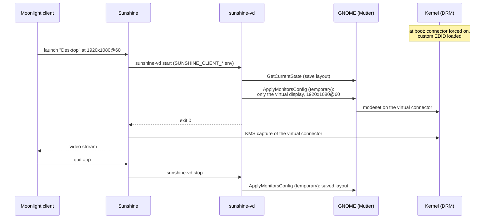

# How it works

sunshine-vd has three moving parts: the kernel, GNOME, and Sunshine. This page explains each one, so you can debug it, port it, or reuse the idea.



## 1. The kernel: a monitor that is not there

Two kernel parameters do the work:

```
drm.edid_firmware=DP-3:edid/sunshine-vd.bin  video=DP-3:e
```

- `drm.edid_firmware` tells the DRM core to use the EDID in `/usr/lib/firmware/edid/sunshine-vd.bin` for the connector `DP-3`, instead of reading one from a monitor.
- `video=DP-3:e` forces the connector to the *connected* state even though nothing is plugged in.

On the **NVIDIA proprietary driver**, `drm.edid_firmware` alone is silently ignored: the connector is only considered when it is also forced on with `:e`. Together, the two parameters expose a fully virtual output. There is no physical link behind it, so the DisplayPort bandwidth limits that cap cheap dummy plugs do not apply.

`nvidia-drm` loads from the initramfs, so the EDID file has to be in the initramfs as well. That is what `/etc/dracut.conf.d/90-sunshine-vd.conf` is for.

No kernel module is built or loaded. Secure Boot does not care, and kernel updates do not break anything.

**How the installer adds the parameters:**
- It uses `grubby --update-kernel=ALL`, then removes them again from the rescue entry, so there is always a clean way to boot.
- `grubby --args=video=…` replaces existing `video=` arguments, so the installer refuses when the command line already has some. It also refuses when another `drm.edid_firmware` override exists.
- The parameters match connectors **by name on every GPU**. A name that exists on two GPUs (say, `DP-2` on both the dGPU and the iGPU) is therefore never used.

### The EDID

`sunshine-vd make-edid` builds a 256-byte EDID 1.4 with one CTA-861 extension:

- **Base block.** The manufacturer ID is `LNX`, which is why GNOME shows the display as "The Linux Foundation". The block holds two detailed timing descriptors (DTDs), a product name, and a display range limits descriptor computed from the modes. The first DTD is the preferred mode.
- **CTA-861 extension.**
  - **Video Data Block:** standard TV modes go here as VICs (1080p60 = VIC 16, 1080p120 = VIC 63, 2160p60 = VIC 97, 720p60 = VIC 4). They cost one byte each.
  - **Video Capability Data Block.**
  - **Up to six more DTDs.**
- **Timings.** Non-standard modes use VESA CVT reduced-blanking (v1) timings. The pixel clock is rounded to the 10 kHz DTD resolution so that the actual refresh rate lands within a few thousandths of a Hz of the requested one.

**Limits:**
- 8 DTDs in total.
- 655.35 MHz maximum pixel clock per DTD (16-bit field), which is why 4K@120 is not possible.

The tests validate the result with `edid-decode --check`.

### Choosing the connector

The installer picks the highest-numbered DisplayPort connector with nothing plugged in, and falls back to HDMI. `sunshine-vd connectors` shows the list. Some NVIDIA cards expose more DP connectors than physical ports. If the EDID does not load on the chosen one (`sunshine-vd doctor` reports it), reinstall with `VD_CONNECTOR=DP-2` and try another.

## 2. GNOME: `org.gnome.Mutter.DisplayConfig`

GNOME on Wayland has no xrandr. Display layouts go through Mutter's D-Bus API, which is what the Settings app and `gdctl` use. sunshine-vd talks to it directly through PyGObject:

- **`GetCurrentState`** returns a serial, the monitors with their modes and supported scales, the current logical monitors and the layout mode.
- **`ApplyMonitorsConfig(serial, method, logical_monitors, properties)`** applies a layout. Its `method` argument:
  - `1` (**temporary**) is applied silently and not saved to `monitors.xml`. Streams use it, so a crash mid-stream never leaves a saved layout behind.
  - `2` (**persistent**) shows the "Keep these display settings?" dialog and is written to `~/.config/monitors.xml`. It is used once, by `sunshine-vd idle` during `--finish`, to store the normal layout with the virtual display **off**. Otherwise GNOME would turn the new "monitor" on at every login.

**What `idle` applies:** the installer saves your layout before the reboot (`~/.config/sunshine-vd/layout.json`), and `idle` applies exactly that: your modes, refresh rates and rotation. It falls back to the current layout without the virtual display, shifted to start at (0, 0), and finally to all monitors side by side. Success is confirmed by `monitors.xml` actually being rewritten.

Before switching, `start` saves a snapshot of the current layout in `$XDG_RUNTIME_DIR/sunshine-vd/state.json`. `stop` re-applies that snapshot and adapts it if a monitor or mode disappeared in the meantime. If the snapshot cannot be applied, `stop` falls back to putting the connected monitors side by side.

**Restoring with `stop`:**
- With no saved stream state, `stop` does nothing unless the virtual display is on.
- A new stream started after a `stop` that could not restore (no physical monitor connected) keeps the original snapshot.

The serial guards against races: if the layout changes between the read and the apply, Mutter rejects the call, and sunshine-vd retries with a fresh state.

During the stream, `gnome-session-inhibit --inhibit idle:suspend` runs as a transient systemd user unit (`sunshine-vd-inhibit`), so GNOME does not blank or suspend while nobody touches the host.

The login screen (GDM) has its own `monitors.xml`. `--finish` offers to copy yours to `/var/lib/gdm/.config/` so the login screen does not open on the virtual display.

## 3. Sunshine

### Prep commands

Sunshine runs every `global_prep_cmd` "do" command before launching any app, and **waits** for each one. "Undo" commands run in reverse order when the app is quit. Each command gets the client's request in its environment:

```
SUNSHINE_CLIENT_WIDTH, SUNSHINE_CLIENT_HEIGHT, SUNSHINE_CLIENT_FPS, SUNSHINE_CLIENT_HDR, SUNSHINE_CLIENT_NAME, ...
```

A failing "do" command aborts the launch, so `sunshine-vd start` and `stop` always exit 0. If anything goes wrong, they log it, and you get a stream of whatever display is active instead of no stream at all.

### Capture

`capture = kms` reads the scanout buffers straight from DRM. Two consequences:

- **Only active planes are listed.** Sunshine enumerates displays when the stream starts, which is after the prep commands ran. By then the virtual display is lit and maps to `output_name = DP-3`. At Sunshine's own startup the virtual display is off, so the log shows `Couldn't map 'DP-3'… Falling back to first monitor`. That is expected: Sunshine uses that fallback only to probe the encoders.
- **KMS capture needs the `cap_sys_admin` capability on the binary.** The RPM sets it; Flatpak cannot.

## Mode selection

`choose_mode()` gets the modes GNOME offers for the virtual display and the client's width, height and FPS. It picks a mode in this order:

1. Keep the resolutions within 1 % of the best aspect-ratio match.
2. Among those, prefer resolutions that offer a refresh rate at least as high as the requested one.
3. Take the smallest resolution that covers the request, with 5 % tolerance. If none does, take the largest.
4. Use the same refresh rate or the next one up.

The 640x480 mode that every EDID must carry is ignored. Scale is 2 for heights of 2000 px and up, otherwise 1, unless `SCALE` is set.

## Manual installation

On distros the installer does not handle yet, the steps are:

1. **Generate the EDID** (pass `--modes` for custom modes):
   ```bash
   ./sunshine-vd make-edid --out sunshine-vd.bin
   ```
2. **Install it** as `/usr/lib/firmware/edid/sunshine-vd.bin`.
3. **Add it to the initramfs:**
   - dracut: `install_items+=" /usr/lib/firmware/edid/sunshine-vd.bin "`;
   - mkinitcpio: `FILES=(/usr/lib/firmware/edid/sunshine-vd.bin)`;
   - initramfs-tools: a hook that copies the file.

   Then rebuild the initramfs.
4. **Add the kernel parameters** with your bootloader (`/etc/default/grub` + `update-grub`, `/etc/kernel/cmdline`, …):
   ```
   drm.edid_firmware=<CONNECTOR>:edid/sunshine-vd.bin video=<CONNECTOR>:e
   ```
5. **Install the helper and set the connector:**
   ```bash
   install -Dm755 sunshine-vd ~/.local/bin/sunshine-vd
   mkdir -p ~/.config/sunshine-vd
   echo "CONNECTOR=<CONNECTOR>" > ~/.config/sunshine-vd/config
   ```
6. **Point Sunshine at it:**
   ```bash
   sunshine-vd sunshine-conf add --connector <CONNECTOR>
   ```
   Then restart Sunshine.
7. **Reboot, then persist the layout with the virtual display off:**
   ```bash
   sunshine-vd idle
   ```
